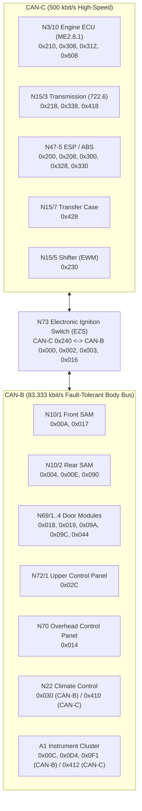

# W463 Body PDM & Gateway Topology (2007–2012 G-Class)

Passive reverse-engineering notes on how the 2007–2012 Mercedes-Benz W463 partitions body electronics across fault-tolerant Interior CAN-B (`83.333 kbit/s`) and high-speed Drivetrain CAN-C (`500 kbit/s`).

> **Scope & Safety Boundary:** This document records passive bus observations and factory architecture analysis for diagnostic and logging purposes. It is not a wiring instruction set or a vehicle injection guide.

## Evidence Grades

- **Measured** — directly observed in passive CAN-B and CAN-C captures on a 2011 W463 test vehicle during physical stimuli (door/lock/window/lighting actuation and key-off thermal soak).
- **Derived** — combined from measured bus behavior and platform electrical architecture diagrams.
- **Borrowed** — field names cross-referenced against the adjacent-platform [`rnd-ash/mb-w211-pc`](https://github.com/rnd-ash/mb-w211-pc) reference.

---

## 1. Dual-Bus Architecture & `N73` (EZS) Gateway Role

On the 2007–2012 W463, there is no standalone `N93` Central Gateway module. The **Electronic Ignition Switch (`N73`, EZS)** serves as both the immobilizer/terminal master and the bridge between **CAN-C** (`500 kbit/s`, ISO 11898-2) and **CAN-B** (`83.333 kbit/s`, ISO 11898-3 fault-tolerant):

### Measured Inter-Bus Gateway Frames (`N73`)

1. **`CAN-C 0x608` -> `CAN-B 0x002` (`GW_C_B1`):**
   - **Measured:** `N73` copies `ME2.8.1` engine coolant temperature (`0x608` byte 0, `raw - 40 °C`) into `CAN-B 0x002` byte 4 (`DLC 7` on W463).
2. **`CAN-C 0x300` + `0x230` -> `CAN-B 0x003` (`GW_C_B2`):**
   - **Measured:** `N73` copies brake light switch status (`BLS_ST`, byte 0 bits `0..1`), selector lever position (`WHC`, byte 1 low nibble), Park status (byte 1 bit 6), and Reverse status (`RG`, byte 1 bit 7) onto CAN-B so the Rear SAM (`N10/2`) illuminates the brake and reverse lamps without direct wiring to the shifter or brake switch.
3. **`CAN-B 0x000` (`EZS_A1`) -> `CAN-C 0x240` (`EZS_240h`):**
   - **Measured:** `N73` broadcasts Terminal `15C` (key inserted), `15R` (accessory), `15` (run), and `50` (starter crank) on `CAN-B 0x000` byte 0 bits `0..4`, and mirrors ignition/lighting state onto `CAN-C 0x240`.

---

## 2. Smart Power Distribution Modules (`N10/1`, `N10/2`, `N69/1..4`)

Unlike earlier W463 generations where switches switched load current directly, the 2007–2012 W463 uses six CAN-B modules as distributed I/O controllers:

| Module | CAN-B Frames (Measured) | Inputs Read Locally | Loads Driven Locally |
|---|---|---|---|
| **Front SAM (`N10/1`)** | `0x00A` (`SAM_V_A1`), `0x017` (`SAM_V_A2`) | Alternator `D+` (`KL_61`), brake fluid switch, washer fluid switch, coolant level switch, brake pad wear loop, front bumper NTC (`0x017` byte 0), R134a pressure sensor (`0x017` bytes 1..2) | Low beams, high beams, front fogs, front turn signals, parking lamps, horn, wiper motor, A/C compressor clutch (`0x017` byte 5 mA); reports individual front bulb open/short faults in `0x00A` bytes 4..5 |
| **Rear SAM (`N10/2`)** | `0x004` (`SAM_H_A1`), `0x00E` (`SAM_H_A3`), `0x090` (`SAM_H_A2`) | All 4 door-pin switches (`0x004` byte 0 bits `0..3`), tailgate pin (bit 4), hood switch (`0x004` byte 1 bit 7), fuel tank level sender (`0x090` byte 0) | Tail/brake/reverse/rear-fog/license-plate lamps, rear window defroster (`0x004` byte 1 bit 3), tailgate & fuel-flap lock actuators, anti-theft alarm (`EDW`, `0x004` byte 2); reports rear bulb faults in `0x004` bytes 3..4 |
| **Door Controllers (`N69/1..4`)** | `0x018` (FL), `0x019` (FR), `0x09A` (RL), `0x09C` (RR), `0x044` (FL master switch) | Door window switches, 12-bit signed Hall-effect window motor counters | 2-wire reversible DC door lock motors (`M14/5..8`), window lift motors (`M10/1..4`), mirror heaters/motors, puddle lamps |

### Central Locking State vs. Door Pin State (Measured)

- **Door Open/Closed (`0x004` `SAM_H_A1`):** Continuous hardware contact state (`0` = closed, `1` = open) for all four doors (`byte 0` bits `0..3`), tailgate (`bit 4`), and hood (`byte 1` bit `7`).
- **Door Lock Actuators (`0x000` `EZS_A1` & `0x02C` `OBF_A1`):** The W463 2-wire lock actuators do not report a continuous mechanical lock-position switch on CAN-B. Instead:
  - `0x000` byte 5 broadcasts `0xAA` on door lock commands and `0x55` on door unlock commands;
  - `0x000` byte 4 bits `5..6` (`0x20`/`0x40`) command tailgate unlock/lock and bits `3..4` (`0x08`/`0x10`) command fuel-flap unlock/lock;
  - `0x000` byte 3 bits `6..7` (`0x40`/`0x80`) report external RF/IR disarm/arm;
  - `0x02C` byte 0 bits `6..7` (`0xC0`) report interior console lock/unlock switch actuation; and
  - `0x004` byte 2 bit 6 (`0x40`, `EDW_AKT`) remains `1` continuously while the factory anti-theft alarm is armed with the vehicle locked.

---

## 3. Key-Off Bus Sleep & `ME2.8.1` Thermal Afterrun (Measured)

1. **Key Removal in Park (`KL_15 -> 0`):**
   - **Measured:** When the key is turned off and removed, `CAN-B` (`83.333 kbit/s`) drops to `0 fps` (bus sleep, recessive levels `CAN-H ≈ 0 V / CAN-L ≈ 5 V`) within a few seconds after the last door closes and the vehicle is locked.
2. **`ME2.8.1` 80-Second CAN-C Afterrun:**
   - **Measured:** On **CAN-C** (`500 kbit/s`), the transmission controller (`N15/3`, `0x218`/`0x338`/`0x418`) and ESP (`N47-5`, `0x200`/`0x208`) stop immediately when Terminal 15 opens, because they are powered via Circuit 15.
   - However, the engine ECU (`N3/10`, `ME2.8.1`) and steering angle sensor (`N49`) are powered via the **Circuit 87 Engine Control Relay (`K40/4kI`)**, which `ME2.8.1` holds energized for **80 seconds after key-off** (`t + 467 s` to `t + 547 s` in measured key-off captures). During this 80-second window, `ME2.8.1` continues broadcasting `0x210`, `0x212`, `0x308` (engine oil temperature), `0x312`, `0x580`, and `0x608` (engine coolant and intake air temperatures) at full rate (`~246 fps` total across 8 IDs), allowing a passive logger to record post-drive thermal soak before Circuit 87 drops.
