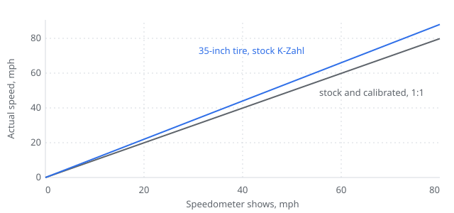

# Custom tire size speedometer calibration for W463 G-Wagons

Put 35-inch tires on a W463 G-Wagon and the speedometer reads about 9 percent low. At an indicated 70 mph the truck is doing about 77 mph, and the odometer logs about 91 miles for every 100 driven. The factory diagnostic tool offers a short list of tire presets and no custom size. This guide compares the three paths, explains how the KI203M instrument cluster stores the tire-size calibration, and documents the cluster's own K-Zahl (Wegimpulszahl) read on a 2011 W463.

The read path is verified on the truck. The write path is bench-only until the EEPROM header checksum is solved. Nothing in this guide has been written to a vehicle.

## How much off is your speedometer?

The cluster computes speed and distance from the wheel-speed signal and a distance impulse number, the K-Zahl. The number is matched to the tire's rolling circumference. Fit a taller tire and the same number of wheel turns covers more ground, so the indicated speed falls below the actual speed and the odometer counts less distance than the truck travels.

The stock tire in this calibration is 2,419 mm. A 35-inch tire rolls about 2,666 mm. The ratio is 2,666 / 2,419 = 1.102, so the actual speed is 10.2 percent above the indicated speed, and the indicated speed is 9.3 percent below the actual speed.

| Speedometer shows | Actual speed, stock K-Zahl | Error | Actual speed, calibrated K-Zahl |
|---|---|---|---|
| 25 mph | 27.6 mph | +2.6 mph (+10.2%) | 25.0 mph |
| 45 mph | 49.6 mph | +4.6 mph (+10.2%) | 45.0 mph |
| 55 mph | 60.6 mph | +5.6 mph (+10.2%) | 55.0 mph |
| 65 mph | 71.6 mph | +6.6 mph (+10.2%) | 65.0 mph |
| 70 mph | 77.1 mph | +7.1 mph (+10.2%) | 70.0 mph |
| 75 mph | 82.7 mph | +7.7 mph (+10.2%) | 75.0 mph |
| 100 miles on the odometer | 110.2 miles travelled | 9.3% under-count | 100.0 miles |

## Tire size and K-Zahl calculator

The K-Zahl is 1664 at 2,419 mm. A 2,666 mm tire needs 1510. The value is a 16-bit word in slot 1 at `0x3900FA`.

The live calculator is on the [site page](https://my-self-driving-g-wagon.drose.io/guides/w463-tire-size-calibration.html); the values below are the 35-inch preset.

  

    <label>Preset
      <select id="kz-preset">
        <option value="2419">Stock, 2,419 mm</option>
        <option value="2530">235/85R16, about 2,530 mm</option>
        <option value="2630">33-inch, about 2,630 mm</option>
        <option value="2666" selected>35-inch, 2,666 mm</option>
      </select>
    </label>
    <label>Rolling circumference, mm
      <input id="kz-circ" type="number" min="1800" max="3200" step="1" value="2666">
    </label>
  

  

    
K-Zahl<b id="kz-k">1510</b>

    
16-bit hex<b id="kz-hex">0x05E6</b>

    
Slot 1 address<b id="kz-addr">0x3900FA</b>

    
Actual over indicated<b id="kz-err">+10.2%</b>

  

  
At an indicated 70 mph the truck is doing 77.1 mph; the odometer logs 90.7 miles per 100 driven.

The calculator rounds the K-Zahl to the nearest integer. The cluster's stored value is a 16-bit word, so the last digit is a calibration choice, not a measurement.

## Comparing the three ways to fix it

| Path | What it changes | Custom circumference | Works today | Cluster EEPROM write |
|---|---|---|---|---|
| Factory Xentry/DAS tire preset | A coded choice among 4 to 6 factory tire sizes | No; the largest is 235/85R16 at 31.7 inches | Yes, with a dealer tool | No |
| Inline CAN correction module | The speed signal between the ABS/ESP unit and the cluster | Yes | Yes | No |
| Native KI203M K-Zahl | The cluster's own distance impulse number | Yes, any circumference | Write path bench-only until the checksum is solved | Yes |

**Factory Xentry/DAS preset.** The tool offers a list of tire sizes in the transfer case and the instrument cluster coding, not a circumference. On a 2010 G55 the list is the same as on a 2005, and the largest option is 235/85R16 at about 31.7 inches. Owners report that the largest preset improves the error but does not clear it for 33-inch and 35-inch tires. The 2013-and-later IC213 cluster has four tire data sets with no descriptions and no raw edit, and the 2019-and-later W463A coding behaves differently again. Both are outside this guide.

**Inline CAN correction module.** A programmable CAN node is installed in front of the cluster. The ABS/ESP unit sends the speed over CAN, and the module adjusts the speed and odometer in real time for the original and the new tire. The Transporter Manufaktur unit is around 550 EUR and the SuperKilometerFilter unit around 400 EUR. This path works today and is reversible. It does not write the cluster EEPROM. The FBS3/FBS4 CAN filters and the mileage stoppers sold for Mercedes clusters are odometer and synchronization tools, not tire calibration; this guide does not cover them.

**Native KI203M K-Zahl.** The cluster's own calibration is a 2-bit selector over four 16-bit override slots. The exact circumference can be set as a 16-bit K-Zahl. The read is verified on the truck; the write is a bench test until the `0xA2C4` header checksum is understood. This is the only path that changes the cluster's computation without adding a box.

## What we found inside the KI203M cluster

The cluster's 93C86 EEPROM has a variant block at `0x3900DE`. The tire-size calibration is a 2-bit selector in the cluster coding (`0x21 0xF0` response byte 9, bits 2..3; the live value is `0x95`, slot 1) over four 16-bit override slots at `0x3900F8-0x3900FE`:

- slot 0 at `0x3900F8`: `0xFFFF`, unset
- slot 1 at `0x3900FA`: `0x7FFF`, unset; the live slot
- slot 2 at `0x3900FC`: `0x7FFF`, unset
- slot 3 at `0x3900FE`: `0x7FFF`, unset

The factory speed curves at `0x390102`, `0x39010E` and `0x39011A` open with 1664, 1664 and 1657, the values for the 2,419 mm stock tire. The 2,666 mm tire calculates to 1510 (`0x05E6`) in slot 1. The full address table, the read layout and the checksum test log are in the [KI203M reference](ki203m-reference.md).

These addresses and values were measured on one 2011 W463 with the KI203M cluster. Other model years, the 2013-and-later IC213 and the 2019-and-later W463A use different hardware and coding.

## What this guide does not do

This is a tire calibration, not an odometer change. The K-Zahl scales how the cluster converts wheel rotation into speed and distance; it does not change accumulated mileage. This guide does not provide odometer rollback or reset instructions, mileage blocker or CAN filter wiring, CGW synchronization defeat, or raw EEPROM dumps. It also does not provide a blind, step-by-step write script for a daily driver.

## Bench write path (paused until the checksum is solved)

The write would use KWP2000 service `0x3D` (WriteMemoryByAddress), whose descriptor at `0x0E05DC` requires security level 5. The level-7 seed and key for the KI203 family are public in UnlockECU, but this cluster rejects the level-7 seed request (`7F 27 12`), and whether level 7 satisfies the level-5 requirement is not established. The request carries a 24-bit address, a length byte and the new bytes, capped at `0x30` bytes. The service writes the SRAM and the EEPROM window, not flash.

The bench plan is to read the block, write the single 16-bit slot in slot 1, recalculate the header value if the checksum algorithm is known, write it, and read the block back. None of that is safe on the truck's cluster until the `0xA2C4` value at `0x3900DE` is understood and a spare cluster has been through the same write and readback. This section is a test plan, not an instruction to run on a vehicle.

## Open problem: the `0xA2C4` header checksum

The 16-bit value `0xA2C4` at `0x3900DE` is not a simple 16-bit sum of the block, and it matches none of the common CRC-16 variants tested so far: CCITT-FALSE, XMODEM, KERMIT, X25, MODBUS and ARC, over the block and over the readable EEPROM window. Whether it is a checksum, a version word or a variant code is still open. If you know the validation the KI203 or a related Mercedes cluster uses, or you can test a spare cluster, open an issue or a pull request on the public repository with the algorithm or the evidence. Do not post a raw EEPROM dump; the offsets and values in the reference are enough to compare notes.

## Frequently asked questions

**Will the largest Xentry/DAS tire preset fix 35-inch tires?** No. The largest factory preset is 235/85R16 at about 31.7 inches. It reduces the error but leaves a gap at 33 inches and above.

**Can I write the 1510 value today?** Not safely. The `0xA2C4` header validation is not solved, and the write is bench-only until it is.

**What works right now?** An inline CAN correction module. The transceiver takes the ABS/ESP speed signal and corrects the speed and odometer before the cluster sees it.

**Does this apply to the 2013-and-later IC213 or the 2019-and-later W463A?** No. Those clusters use different hardware and coding tables.

**Does this change or reset my odometer?** No. The K-Zahl sets the scaling for future speed and distance. It does not change accumulated mileage.

**Why not just use a GPS speedometer app or an external display?** An external display or GPS app shows a corrected number for the driver, but the cluster's own speed output and odometer still use the stored K-Zahl. This work corrects the cluster.

## Prior art and sources

The K-Zahl concept and the checksum problem are documented for the VW cluster community in [gmenounos/vwcluster](https://github.com/gmenounos/vwcluster). The KI203 family seed and key are public in [UnlockECU](https://github.com/jglim/UnlockECU). The W203 and W211 EEPROM and Vediamo threads on MHH Auto and the W463 tire-size threads on MBWorld and PointedThree are the public discussion this guide builds on. The full list, with the aftermarket product pages and the 2013-and-later notes, is in [sources.md](https://github.com/cipher982/g55-public/blob/main/guides/w463-tire-size-calibration/sources.md).
