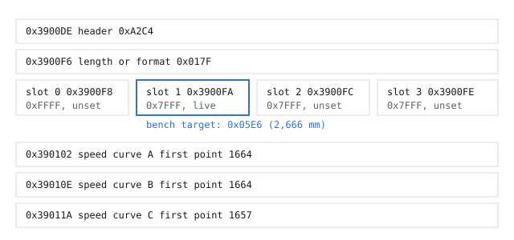

# KI203M reference: the tire-size calibration

Technical reference for the W463 KI203M instrument cluster's tire-size calibration. The [main guide](index.md) explains the owner-facing side, the options and the safety boundaries.

## Evidence grades

- **Measured on the truck:** the EEPROM addresses and values in this page, the coding selector, the factory speed-curve openings. One 2011 W463 with the KI203M cluster.
- **Derived:** the 1510 K-Zahl from the 1664 stock value and the 2,419 / 2,666 mm circumferences; the percentage errors in the main guide.
- **Borrowed:** the factory tire preset list, the aftermarket modules, the 2013-and-later IC213 behavior.
- **Bench-only:** every write to the cluster.
- **Open:** the `0xA2C4` header validation.

## The read path

The cluster answers KWP2000 service `0x23` (ReadMemoryByAddress) in the session opened with `0x10 0x92`. No security access is required for these reads. The largest single read is `0x30` bytes; a `0x31`-byte request is refused. The session lasts about a second, and the service has a duty cycle: two hundred 32-byte reads at one every 2.7 seconds ran clean, ten at one every 2 seconds locked the service for over twenty minutes while the session continued to answer, and 48-byte reads at one every 4 seconds ran clean. A key cycle clears the lockout.

## The tire-size block

| Address | Bytes | Field | Value |
|---|---|---|---|
| `0x3900DE` | 2 | block header | `0xA2C4` |
| `0x3900F6` | 2 | length or format word | `0x017F`; role not established |
| `0x3900F8` | 2 | override slot 0 | `0xFFFF`, unset |
| `0x3900FA` | 2 | override slot 1, live | `0x7FFF`, unset |
| `0x3900FC` | 2 | override slot 2 | `0x7FFF`, unset |
| `0x3900FE` | 2 | override slot 3 | `0x7FFF`, unset |
| `0x390102` | 2 | speed curve A, first point | 1664 |
| `0x39010E` | 2 | speed curve B, first point | 1664 |
| `0x39011A` | 2 | speed curve C, first point | 1657 |

The cluster coding read `0x21 0xF0` returns 20 bytes. Byte 9, bits 2..3, is the K-Zahl selector; the live value is `0x95`, which is slot 1. The four selector values are `0x91`, `0x95`, `0x99` and `0x9D` for slots 0 to 3.

The 2,666 mm tire needs 1510 (`0x05E6`) at `0x3900FA`. The addresses and values above are the read-only evidence for that calculation.

## The write path

The write is KWP2000 service `0x3D` (WriteMemoryByAddress), descriptor `0x0E05DC`, security level 5. The level-7 seed and key for the KI203 family are public in UnlockECU, but this cluster rejects the `27 07` seed request (`7F 27 12`); the level-5 unlock is not demonstrated, and the relationship between the two levels is not established. The request carries a 24-bit address, a length byte and the new bytes; the length is capped at `0x30`. The service writes the SRAM and the EEPROM window `0x390000-0x3907FF`, not flash.

Never write `0x000000-0x000FFF` (the SFR and flash-control registers), `0x03C000-0x03D89C` (the live stack), or `0x390000-0x3900DD` (the odometer and SSID region). The slot write is the only change in the plan.

## The `0xA2C4` header

The 16-bit value at `0x3900DE` is not a simple 16-bit sum of the block, and it matches none of the common CRC-16 variants tested: CCITT-FALSE, XMODEM, KERMIT, X25, MODBUS and ARC, over the block from `0x3900DE` to `0x39025D` (the `0x017F` length) and over the whole readable window. Whether it is a checksum, a version word or a variant code is open.

If you can compare notes, post the header value and the block it covers, or the validation code. Do not post a raw EEPROM dump; the offsets and values here are enough to compare.

## What this does not show

- One 2011 W463 with the KI203M cluster. Other model years, the 2013-and-later IC213 and the 2019-and-later W463A use different hardware and coding.
- The checksum is unsolved; the write has not been run on a vehicle.
- The read path is measured; the 1510 value is calculated, not written and read back on a cluster.
- The 4-second read pacing is the safe rate from the earlier sessions; a slower rate is safer.
